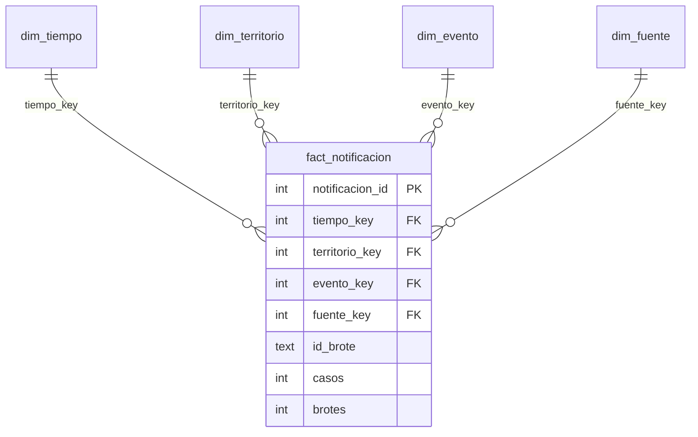

# Modelo estrella multifuente NexoBio-ETV

El esquema SQLite de referencia se crea con [`scripts/olap/crear_modelo.sql`](../../scripts/olap/crear_modelo.sql), se carga con [`scripts/olap/cargar_modelo.py`](../../scripts/olap/cargar_modelo.py) y se visualiza en [`static/img/olap_estrella.svg`](../../static/img/olap_estrella.svg). La carga integra SIVIGILA Colombia, SIVIGILA Cundinamarca y OMS/HDX.

## Granularidad y medidas

La granularidad es evento × territorio × periodo × fuente. SIVIGILA Colombia contiene casos por municipio y semana epidemiológica; SIVIGILA Cundinamarca contiene casos por municipio y año (semana 0); OMS/HDX registra un brote por país y año (semana 0). `id_brote` distingue brotes que comparten país, evento y año; para registros de casos es una cadena vacía.

| Medida | Cálculo | Regla |
|---|---|---|
| Casos notificados | `SUM(casos)` | Aditiva en las fuentes SIVIGILA. |
| Brotes reportados | `SUM(brotes)` | Cada registro OMS/HDX aporta 1. |
| Registros | `COUNT(*)` | Observaciones del hecho, no personas ni casos. |

`casos` y `brotes` son excluyentes por registro. No se deben sumar entre sí ni comparar sin explicitar sus diferentes unidades. Las fuentes nacional y regional tienen cobertura superpuesta; para evitar duplicar Cundinamarca, los análisis de casos seleccionan una fuente a la vez.

## Diccionario

| Tabla | Campo | Tipo | Clave / regla | Descripción |
|---|---|---|---|---|
| `dim_tiempo` | `tiempo_key` | INTEGER | PK; `anio * 100 + semana` | Clave de año-semana. |
| | `anio` | INTEGER | NOT NULL | Año de observación. |
| | `semana` | INTEGER | 0–53 | Semana epidemiológica; 0 para observaciones anuales. |
| | `trimestre_epi` | INTEGER | 0–4 | Trimestre 0 para datos anuales; 1–4 para semanas. |
| | `trimestre_epi_nombre` | TEXT | NOT NULL | Etiqueta de trimestre o «Sin semana». |
| | `periodo` | TEXT | NOT NULL | Intervalo de brotes OMS/HDX (1996–2008, 2009–2019, 2020–2026) o «No aplica». |
| | `periodo_analisis` | TEXT | NOT NULL | Periodos 2007–2010, 2011–2016, 2017–2022 u otras fechas fuera de esos rangos. |
| | `tipo_anio_sivigila` | TEXT | NOT NULL | Epidémico, no epidémico o «No aplica» según la serie anual SIVIGILA. |
| | `anio_completo` | TEXT | `Si` / `No` | Marca el año 2026 como incompleto. |
| `dim_territorio` | `territorio_key` | INTEGER | PK | Clave sustituta. |
| | `ambito` | TEXT | Colombia / Mundo | Distingue las jerarquías geográficas. |
| | `region` | TEXT | NOT NULL | Región natural colombiana, región OMS o categoría sin región. |
| | `area` | TEXT | NOT NULL | Departamento colombiano o país. |
| | `localidad` | TEXT | NOT NULL | Municipio o «No aplica». |
| | `codigo_territorio` | TEXT | Único con `ambito` | Código de municipio DANE o ISO3 de país. |
| | `cod_departamento` | TEXT | Nullable | Código DANE colombiano. |
| | `subregion_onu` | TEXT | Nullable | Subregión ONU del país. |
| `dim_evento` | `evento_key` | INTEGER | PK | Clave sustituta. |
| | `catalogo` | TEXT | SIVIGILA / CIE-10 OMS | Catálogo de origen. |
| | `cod_evento` | TEXT | Nullable | Código SIVIGILA o código de evento OMS. |
| | `evento` | TEXT | Único por catálogo y cobertura | Etiqueta original del evento. |
| | `enfermedad` | TEXT | NOT NULL | Nombre armonizado entre fuentes. |
| | `vector` | TEXT | NOT NULL | Vector asociado o «No especificado». |
| | `cobertura` | TEXT | Nacional / Solo Cundinamarca / Global | Alcance del evento en la fuente. |
| | `capitulo_cie10` | TEXT | Nullable | Capítulo o bloque CIE-10 OMS. |
| | `anio_primer_registro` | INTEGER | NOT NULL | Primer año observado para evento y cobertura. |
| `dim_fuente` | `fuente_key` | INTEGER | PK | Clave sustituta. |
| | `fuente` | TEXT | UNIQUE | SIVIGILA Colombia, SIVIGILA Cundinamarca u OMS/HDX. |
| | `escala` | TEXT | Global / Nacional / Regional | Escala geográfica de la fuente. |
| | `unidad_medida` | TEXT | NOT NULL | Casos notificados o brotes reportados. |
| | `archivo_origen` | TEXT | NOT NULL | Archivo consolidado de entrada. |
| `fact_notificacion` | `notificacion_id` | INTEGER | PK | Identificador sustituto de la fila. |
| | `tiempo_key`, `territorio_key`, `evento_key`, `fuente_key` | INTEGER | FK | Claves hacia las cuatro dimensiones. |
| | `id_brote` | TEXT | NOT NULL, default `''` | Identificador degenerado del brote. |
| | `casos` | INTEGER | Nullable; ≥ 1 si informado | Medida de casos. |
| | `brotes` | INTEGER | Nullable; = 1 si informado | Medida de brotes. |

## Jerarquías

| Dimensión | Jerarquía |
|---|---|
| Tiempo | Periodo → Año → Trimestre epidemiológico → Semana |
| Territorio | Ámbito → Región → Área → Localidad |
| Evento | Vector → Enfermedad → Evento |
| Fuente | Escala → Fuente |

Para Colombia, territorio corresponde a región natural → departamento → municipio. Para el ámbito mundial, corresponde a región OMS → país → «No aplica». Semana 0 representa las fuentes que solo proporcionan datos anuales.

## Vistas interactivas

- **Concentración, ciclos y gravedad:** permiten elegir SIVIGILA Colombia o SIVIGILA Cundinamarca. Las medidas permanecen en casos y la escala anual de la fuente regional no se interpreta como semanas epidemiológicas.
- **Estacionalidad:** usa SIVIGILA Colombia, la única fuente de casos con semana epidemiológica.
- **Brotes OMS/HDX:** vista dedicada con filtros por año, región OMS y enfermedad; muestra brotes reportados y nunca los suma a los casos SIVIGILA.

Las reglas de clasificación de eventos OMS/HDX proceden de `datos/clasificacion_enfermedad_hdx.csv`; los eventos SIVIGILA se clasifican con `datos/clasificacion_evento_vigilancia.csv`. La carga comprueba las claves, referencias, grano, exclusividad de medidas y conciliación con las filas y conteos de las tres fuentes.
