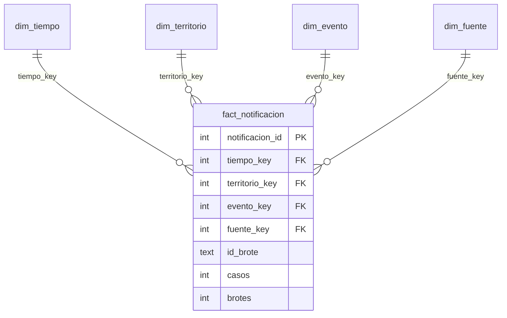

# Modelo estrella NexoBio-ETV (diseño multifuente)

El esquema de la etapa 5 está definido en [`scripts/olap/crear_modelo.sql`](../../scripts/olap/crear_modelo.sql) y representado en [`static/img/olap_estrella.svg`](../../static/img/olap_estrella.svg). Contiene una tabla de hechos y cuatro dimensiones compartidas por las fuentes. Las decisiones que lo delimitan (qué se carga, qué se excluye y por qué) están en [`decisiones_modelo.md`](decisiones_modelo.md).

> **Estado de implementación:** el esquema y las decisiones de diseño están cerrados. El cargador, las consultas, las vistas interactivas y las páginas todavía usan el modelo operativo SIVIGILA (`scripts/olap/crear_modelo_sivigila.sql`) y se están migrando a este modelo. Hasta que termine la migración, las cifras de las vistas no incluyen CIE-10 OMS ni brotes globales.

## Qué se carga

Solo enfermedades transmitidas por vectores (ETV), en tres fuentes que no se solapan:

| Fuente | Escala | Contenido cargado | Filas | Medida |
|---|---|---|---:|---|
| SIVIGILA Colombia | Nacional | Dengue, dengue grave, chikungunya y chagas, 2007–2022 | 237.141 | 1.269.342 casos |
| SIVIGILA Cundinamarca | Regional | Zika, malaria (5 variantes) y leishmaniasis (3 variantes), 2007–2022 | 3.747 | 8.782 casos |
| OMS / HDX | Global | Brotes ETV, 1996–2026 | 563 | 563 brotes |

No se cargan los eventos ya incluidos en el nacional que repite el archivo de Cundinamarca, el archivo regional ETV (se usa para validar), los eventos que no son ETV ni los eventos de mortalidad (defunciones, no casos). Total esperado: 241.451 filas.

## Granularidad y medidas

`fact_notificacion` registra una observación de un evento, territorio, periodo y fuente. Para SIVIGILA, el grano es evento × municipio × semana epidemiológica × año; para los brotes OMS, evento × país × año, con `semana = 0`. `id_brote` es una dimensión degenerada: identifica el brote y es una cadena vacía para registros de vigilancia. La clave primaria es `notificacion_id`; una restricción `UNIQUE` evita duplicar la combinación fuente, tiempo, territorio, evento e identificador del brote.

| Medida | Cálculo | Uso |
|---|---|---|
| Casos notificados | `SUM(casos)` | Aditiva para filas de casos. |
| Brotes reportados | `SUM(brotes)` | Aditiva para filas de brotes; cada fila aporta 1. |
| Registros | `COUNT(*)` | Cuenta observaciones, no personas ni casos. |

`casos` y `brotes` son excluyentes por registro. No se deben sumar juntos ni comparar como si compartieran unidad. Los porcentajes se calculan sobre sus numeradores y denominadores, nunca sumando porcentajes de grupos.

## Diccionario de datos

| Tabla | Campo | Tipo | Clave / regla | Descripción |
|---|---|---|---|---|
| `dim_tiempo` | `tiempo_key` | INTEGER | PK; `anio * 100 + semana` | Clave de año y semana; semana 0 identifica un registro anual. |
| | `anio` | INTEGER | NOT NULL | Año calendario o epidemiológico de la fuente. |
| | `semana` | INTEGER | 0–53 | Semana epidemiológica; 0 cuando el dato es anual. |
| | `trimestre_epi` | INTEGER | 0–4 | Trimestre epidemiológico; 0 para el nivel anual. |
| | `trimestre_epi_nombre` | TEXT | NOT NULL | Etiqueta del trimestre o de «Sin semana». |
| | `periodo` | TEXT | NOT NULL | Corte para series largas de brotes: 1996–2008, 2009–2019, 2020–2025 o 2026 (incompleto). |
| | `periodo_analisis` | TEXT | CHECK | Corte de las vistas SIVIGILA: 2007–2010, 2011–2016, 2017–2022 o «Fuera de 2007-2022». |
| | `tipo_anio_sivigila` | TEXT | CHECK | «Epidemico» si los casos ETV del año en SIVIGILA Colombia superan el promedio anual (79.334); «No epidemico»; «No aplica» fuera de 2007–2022. |
| | `anio_completo` | TEXT | `Si` / `No` | Indica si el año está completo (2026 no lo está). |
| `dim_territorio` | `territorio_key` | INTEGER | PK | Clave sustituta. |
| | `ambito` | TEXT | `Colombia` / `Mundo` | Distingue jerarquías nacionales y globales. |
| | `region` | TEXT | NOT NULL | Región natural, región OMS, «Sin region» o «No geografico». |
| | `area` | TEXT | NOT NULL | Departamento en Colombia o país en el mundo; «Exterior» y «Procedencia desconocida» en las categorías no geográficas. |
| | `localidad` | TEXT | NOT NULL | Municipio, país de procedencia en «Exterior», o «No aplica». |
| | `codigo_territorio` | TEXT | UNIQUE con `ambito` | Código DANE o nombre del país. |
| | `cod_departamento` | TEXT | Nullable | Código DANE del departamento colombiano. |
| | `subregion_onu` | TEXT | Nullable | Subregión ONU para registros mundiales. |
| `dim_evento` | `evento_key` | INTEGER | PK | Clave sustituta. |
| | `catalogo` | TEXT | `SIVIGILA` / `CIE-10 OMS` | Catálogo de origen del evento. |
| | `cod_evento` | TEXT | Nullable | Código del evento SIVIGILA, si aplica. |
| | `evento` | TEXT | Único con `catalogo` | Nombre original del evento o de la enfermedad OMS. |
| | `enfermedad` | TEXT | NOT NULL | Enfermedad armonizada entre catálogos. |
| | `vector` | TEXT | CHECK | Mosquito, Triatomino, Flebotomo, Pulga, Piojo o No especificado. |
| | `cobertura` | TEXT | Nacional / Solo Cundinamarca / Global | Cobertura geográfica de la observación. |
| | `capitulo_cie10` | TEXT | Nullable | Capítulo CIE-10 OMS, si aplica. |
| | `anio_primer_registro` | INTEGER | Nullable | Primer año con notificación en la fuente; los años previos son «sin vigilancia», no cero. |
| `dim_fuente` | `fuente_key` | INTEGER | PK | Clave sustituta. |
| | `fuente` | TEXT | UNIQUE | Nombre de la fuente de datos. |
| | `escala` | TEXT | Global / Nacional / Regional | Escala de la fuente. |
| | `unidad_medida` | TEXT | CHECK | Casos notificados o brotes reportados. |
| | `archivo_origen` | TEXT | NOT NULL | Archivo empleado en la carga. |
| `fact_notificacion` | `notificacion_id` | INTEGER | PK | Identificador sustituto de la observación. |
| | `tiempo_key`, `territorio_key`, `evento_key`, `fuente_key` | INTEGER | FK | Enlace a cada dimensión. |
| | `id_brote` | TEXT | NOT NULL, default `''` | Identificador de brote; vacío en vigilancia. |
| | `casos` | INTEGER | Nullable; ≥ 1 si informado | Medida de casos notificados. |
| | `brotes` | INTEGER | Nullable; = 1 si informado | Indicador aditivo de un brote reportado. |

## Jerarquías dimensionales

| Dimensión | Jerarquía | Notas |
|---|---|---|
| Tiempo | Periodo de análisis → Año → Trimestre epidemiológico → Semana | Semana 0 representa datos anuales sin semana. `periodo` agrupa los años de la serie de brotes (1996–2026). |
| Territorio | Ámbito → Región → Área → Localidad | Colombia: región natural → departamento → municipio. Mundo: región OMS → país → «No aplica». Agrupar siempre junto con `ámbito`. |
| Evento | Vector → Enfermedad → Evento | La clasificación por vector la define el equipo según el agente transmisor. |
| Fuente | Escala → Fuente | Escalas global, nacional y regional. |

## Reglas para consultar el modelo

1. **Una unidad por consulta.** Filtrar por fuente (o por `casos` / `brotes`); nunca sumar casos con brotes.
2. **Agrupar por ámbito.** `area` mezcla departamentos y países.
3. **Rankings territoriales de Colombia** excluyen `region = 'No geografico'` (Exterior y Procedencia desconocida); esos casos se conservan en el modelo con categoría propia.
4. **Estacionalidad** usa semanas 1–52 (la semana 53 solo existe en 2008, 2014 y 2020) y excluye la semana 0.
5. **Zika, malaria y leishmaniasis** solo existen para Cundinamarca (`cobertura = 'Solo Cundinamarca'`); no se presentan como cifras nacionales.
6. **Años sin vigilancia.** Antes de `anio_primer_registro` no hay notificación; no equivale a cero casos.
7. **2026** es un año incompleto en los brotes OMS; se excluye al comparar periodos.

## Correspondencia y alcance

- SIVIGILA: evento y conteo se asignan a `dim_evento` y `casos`; municipio y departamento a `dim_territorio`; año y semana a `dim_tiempo`; archivo y unidad a `dim_fuente`.
- CIE-10 OMS: catálogo, capítulo y enfermedad armonizada se registran en `dim_evento`.
- Brotes globales: país, región OMS y subregión ONU se registran en `dim_territorio`; identificador del brote en `id_brote`; cada brote aporta `brotes = 1` y usa semana 0.

La correspondencia campo a campo entre las columnas originales y el modelo se documenta junto con el cargador de la etapa 5.
