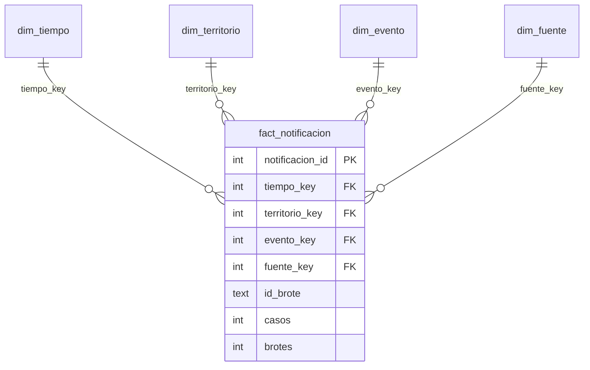

# Modelo estrella NexoBio-ETV (diseño multifuente)

El esquema de referencia de la etapa 5 está definido en [`scripts/olap/crear_modelo.sql`](../../scripts/olap/crear_modelo.sql) y representado en [`static/img/olap_estrella.svg`](../../static/img/olap_estrella.svg). Contiene una tabla de hechos y cuatro dimensiones compartidas por las fuentes.

> **Estado de implementación:** el esquema multifuente es el modelo objetivo. Las vistas interactivas y sus validaciones todavía usan el modelo operativo SIVIGILA de `scripts/olap/crear_modelo_sivigila.sql`, cargado desde el CSV colombiano. No deben interpretarse como resultados de CIE-10 OMS ni de brotes globales.

## Granularidad y medidas

`fact_notificacion` registra una observación de un evento, territorio, periodo y fuente. Para SIVIGILA, el grano es evento × municipio × semana epidemiológica × año; para los brotes OMS, evento × país × año, con `semana = 0`. `id_brote` es una dimensión degenerada: identifica el brote y es una cadena vacía para registros de vigilancia. La clave primaria es `notificacion_id`; una restricción `UNIQUE` evita duplicar la combinación fuente, tiempo, territorio, evento e identificador del brote.

| Medida | Cálculo | Uso |
|---|---|---|
| Casos notificados | `SUM(casos)` | Aditiva para filas de casos. |
| Brotes reportados | `SUM(brotes)` | Aditiva para filas de brotes; cada fila aporta 1. |
| Registros | `COUNT(*)` | Cuenta observaciones, no personas ni casos. |

`casos` y `brotes` son excluyentes por registro. No se deben sumar juntos ni comparar como si compartieran unidad. Los porcentajes se calculan sobre sus numeradores y denominadores, nunca sumando porcentajes de grupos.

## Diccionario de datos

| Tabla | Campo | Tipo | Clave / regla | Descripción |
|---|---|---|---|---|
| `dim_tiempo` | `tiempo_key` | INTEGER | PK; `anio * 100 + semana` | Clave de año y semana; semana 0 identifica un registro anual. |
| | `anio` | INTEGER | NOT NULL | Año calendario o epidemiológico de la fuente. |
| | `semana` | INTEGER | 0–53 | Semana epidemiológica; 0 cuando el dato es anual. |
| | `trimestre_epi` | INTEGER | 0–4 | Trimestre epidemiológico; 0 para el nivel anual. |
| | `trimestre_epi_nombre` | TEXT | NOT NULL | Etiqueta del trimestre o de «Sin semana». |
| | `periodo` | TEXT | NOT NULL | Periodo analítico: 1996–2008, 2009–2019, 2020–2025 o 2026 (incompleto), según la fuente. |
| | `anio_completo` | TEXT | `Si` / `No` | Indica si el año está completo. |
| `dim_territorio` | `territorio_key` | INTEGER | PK | Clave sustituta. |
| | `ambito` | TEXT | `Colombia` / `Mundo` | Distingue jerarquías nacionales y globales. |
| | `region` | TEXT | NOT NULL | Región natural o región OMS. |
| | `area` | TEXT | NOT NULL | Departamento en Colombia o país en el mundo. |
| | `localidad` | TEXT | NOT NULL | Municipio o «No aplica». |
| | `codigo_territorio` | TEXT | UNIQUE con `ambito` | Código DANE o nombre del país. |
| | `cod_departamento` | TEXT | Nullable | Código DANE del departamento colombiano. |
| | `subregion_onu` | TEXT | Nullable | Subregión ONU para registros mundiales. |
| `dim_evento` | `evento_key` | INTEGER | PK | Clave sustituta. |
| | `catalogo` | TEXT | `SIVIGILA` / `CIE-10 OMS` | Catálogo de origen del evento. |
| | `cod_evento` | TEXT | Nullable | Código del evento SIVIGILA, si aplica. |
| | `evento` | TEXT | Único con `catalogo` | Nombre original del evento o código descriptivo. |
| | `enfermedad` | TEXT | NOT NULL | Enfermedad armonizada entre catálogos. |
| | `grupo` | TEXT | `ETV` / `No ETV` | Clasificación del evento. |
| | `cobertura` | TEXT | Nacional / Solo Cundinamarca / Global | Cobertura geográfica de la observación. |
| | `capitulo_cie10` | TEXT | Nullable | Capítulo CIE-10 OMS, si aplica. |
| `dim_fuente` | `fuente_key` | INTEGER | PK | Clave sustituta. |
| | `fuente` | TEXT | UNIQUE | Nombre de la fuente de datos. |
| | `escala` | TEXT | Global / Nacional / Regional | Escala de la fuente. |
| | `unidad_medida` | TEXT | NOT NULL | Casos notificados o brotes reportados. |
| | `archivo_origen` | TEXT | NOT NULL | Archivo empleado en la carga. |
| `fact_notificacion` | `notificacion_id` | INTEGER | PK | Identificador sustituto de la observación. |
| | `tiempo_key`, `territorio_key`, `evento_key`, `fuente_key` | INTEGER | FK | Enlace a cada dimensión. |
| | `id_brote` | TEXT | NOT NULL, default `''` | Identificador de brote; vacío en vigilancia. |
| | `casos` | INTEGER | Nullable; ≥ 1 si informado | Medida de casos notificados. |
| | `brotes` | INTEGER | Nullable; = 1 si informado | Indicador aditivo de un brote reportado. |

## Jerarquías dimensionales

| Dimensión | Jerarquía | Notas |
|---|---|---|
| Tiempo | Periodo → Año → Trimestre epidemiológico → Semana | Semana 0 representa datos anuales sin semana. |
| Territorio | Ámbito → Región → Área → Localidad | Colombia: región natural → departamento → municipio. Mundo: región OMS → país → «No aplica». |
| Evento | Grupo → Enfermedad → Evento | Integra SIVIGILA y CIE-10 OMS; el evento conserva catálogo y cobertura. |
| Fuente | Escala → Fuente | Escalas global, nacional y regional. |

## Correspondencia y alcance operativo

- SIVIGILA: evento y conteo se asignan a `dim_evento` y `casos`; municipio y departamento a `dim_territorio`; año y semana a `dim_tiempo`; archivo y unidad a `dim_fuente`.
- CIE-10 OMS: catálogo, código/capítulo y enfermedad armonizada se registran en `dim_evento`.
- Brotes globales: país, región OMS y subregión ONU se registran en `dim_territorio`; identificador del brote en `id_brote`; cada brote aporta `brotes = 1` y usa semana 0.

La aplicación todavía carga y valida únicamente el conjunto colombiano de vigilancia mediante `scripts/olap/cargar_modelo.py` y el esquema `scripts/olap/crear_modelo_sivigila.sql`. El modelo multifuente de referencia no tiene aún una carga consolidada ni resultados interactivos.
