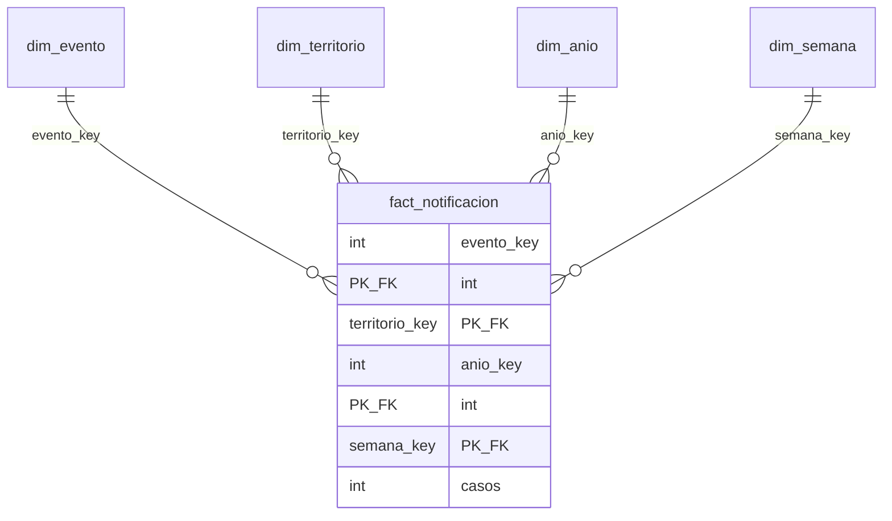

# Modelo estrella NexoBio-ETV (Etapa 5)

Diagrama: `static/img/olap_estrella.svg` (el mismo que muestra la aplicación en *Análisis multidimensional → Modelo estrella*).

**Tabla de hechos `fact_notificacion`.** Un registro = casos notificados de **un evento, en un municipio, en una semana epidemiológica de un año** (237.141 registros, 1.269.342 casos). Unidad de análisis: cantidad agregada de casos notificados (no personas).

## Diccionario de datos

| Tabla | Campo | Tipo | Clave | Descripción |
|---|---|---|---|---|
| fact_notificacion | evento_key | INTEGER | PK, FK → dim_evento | Evento notificado |
| | territorio_key | INTEGER | PK, FK → dim_territorio | Municipio de ocurrencia |
| | anio_key | INTEGER | PK, FK → dim_anio | Año |
| | semana_key | INTEGER | PK, FK → dim_semana | Semana epidemiológica |
| | casos | INTEGER (> 0) | | Casos notificados (`conteo` del archivo tratado) |
| dim_evento | evento_key | INTEGER | PK | Clave sustituta |
| | cod_evento | INTEGER | único | Código `cod_eve` del INS |
| | evento | TEXT | único | DENGUE, DENGUE GRAVE, CHIKUNGUNYA, CHAGAS |
| | familia | TEXT | | Dengue, Chikungunya, Chagas |
| | vector | TEXT | | Aedes, Triatominos |
| dim_territorio | territorio_key | INTEGER | PK | Clave sustituta |
| | cod_municipio | INTEGER | único | Código DANE del municipio (`cod_mun_o`) |
| | municipio | TEXT | | Nombre del municipio |
| | cod_departamento | INTEGER | | Código del departamento (`cod_dpto_o`) |
| | departamento | TEXT | | Nombre para mostrar |
| | region_natural | TEXT | | Andina, Caribe, Pacífica, Orinoquía, Amazonía, Insular o «No aplica» |
| | tipo_ubicacion | TEXT | | Municipio, Sin municipio asignado, Exterior, Procedencia desconocida |
| dim_anio | anio_key | INTEGER | PK | Año 2007–2022 |
| | periodo | TEXT | | 2007-2010, 2011-2016, 2017-2022 |
| | tipo_anio | TEXT | | Epidémico si los casos del año superan el promedio anual (79.334) |
| dim_semana | semana_key | INTEGER | PK | Semana epidemiológica 1–53 |
| | trimestre_epi | INTEGER | | 1–4 |
| | trimestre | TEXT | | T1 (sem 1-13) … T4 (sem 40-53) |

## Jerarquías

| Dimensión | Jerarquía | Validez de la agrupación |
|---|---|---|
| Evento | vector → familia → evento | Cada evento tiene una familia y cada familia un vector |
| Territorio | región natural → departamento → municipio | Cada municipio pertenece a un solo departamento (verificado) |
| Año | periodo → año | Los periodos son rangos de años sin traslape |
| Semana | trimestre epidemiológico → semana | Cada semana pertenece a un solo trimestre |

## Medidas

| Medida | Fórmula | Agregación | Observación |
|---|---|---|---|
| Casos notificados | `SUM(casos)` | Suma | Aditiva en todas las dimensiones |
| Registros de notificación | `COUNT(*)` | Conteo | No son casos ni personas |
| Municipios con casos | `COUNT(DISTINCT territorio_key)` | Conteo distinto | No aditiva |
| % de dengue grave | `100 × SUM(casos dengue grave) / SUM(casos dengue + dengue grave)` | Razón recalculada | Nunca se suma ni se promedia entre grupos |
| % promedio del total anual | Por unidad y año: casos del periodo / casos del año; promedio de los años | Razón por año + promedio | Excluye la semana 53 |

## Correspondencia con el archivo de origen

`cod_eve`, `nombre_evento` → dim_evento · `cod_mun_o`, `municipio_ocurrencia`, `cod_dpto_o` (+ `dim_departamento.csv`) → dim_territorio · `ano` → dim_anio · `semana` → dim_semana · `conteo` → fact_notificacion.casos.
Transformaciones adicionales: región natural (tabla de correspondencia por código de departamento), familia y vector (tabla de correspondencia por evento), periodo y tipo de año (reglas en `scripts/olap/cargar_modelo.py`), trimestre epidemiológico = (semana − 1) // 13 + 1.
