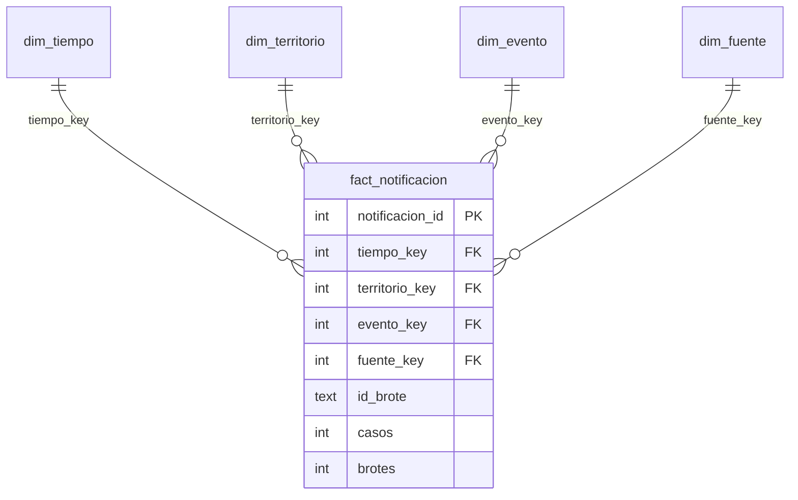

# Modelo estrella NexoBio-ETV (diseño multifuente)

El esquema de la etapa 5 está definido en [`scripts/olap/crear_modelo.sql`](../../scripts/olap/crear_modelo.sql) y representado en [`static/img/olap_estrella.svg`](../../static/img/olap_estrella.svg). Contiene una tabla de hechos y cuatro dimensiones compartidas por las fuentes. Las decisiones que lo delimitan (qué se carga, qué se excluye y por qué) están en [`decisiones_modelo.md`](decisiones_modelo.md).

> **Estado de implementación:** el modelo está cargado y conectado a las consultas y vistas de la Etapa 5. La base, las cifras y las validaciones se regeneran con `python scripts/olap/cargar_modelo.py`.

## Qué se carga

Solo enfermedades transmitidas por vectores (ETV), en tres fuentes. Las coberturas nacional y regional de SIVIGILA se superponen; por eso las consultas de casos filtran una sola fuente y nunca suman ambas.

| Fuente | Escala | Contenido cargado | Filas | Medida |
|---|---|---|---:|---|
| SIVIGILA Colombia | Nacional | Dengue, dengue grave, chikungunya y chagas, 2007–2022 | 237.141 | 1.269.342 casos |
| SIVIGILA Cundinamarca | Regional | Eventos ETV por municipio y año, 2007–2022 | 1.640 | 42.430 casos |
| OMS / HDX | Global | Brotes ETV, 1996–2026 | 563 | 563 brotes |

No se cargan los eventos que no son ETV ni los eventos de mortalidad (defunciones, no casos). Total cargado: 239.344 filas. Los casos nacionales suman 1.269.342 en todas las geografías (1.265.731 en departamentos); los regionales suman 42.430. No se debe sumar el total nacional con el regional porque el registro de Cundinamarca ya está representado en la fuente nacional.

## Granularidad y medidas

`fact_notificacion` registra una observación de un evento, territorio, periodo y fuente. Para SIVIGILA Colombia, el grano es evento × municipio × semana epidemiológica × año; el archivo regional está agregado por evento × municipio × año y usa `semana = 0`. Para OMS/HDX el grano es un brote × enfermedad × país × año, también con `semana = 0`. `id_brote` es una dimensión degenerada: identifica el brote y es una cadena vacía para vigilancia. La clave primaria es `notificacion_id`; `UNIQUE` evita duplicar la combinación de fuente, tiempo, territorio, evento e identificador.

| Medida | Cálculo | Uso |
|---|---|---|
| Casos notificados | `SUM(casos)` | Aditiva para filas de casos. |
| Brotes reportados | `SUM(brotes)` | Aditiva para filas de brotes; cada fila aporta 1. |
| Registros | `COUNT(*)` | Cuenta observaciones, no personas ni casos. |

`casos` y `brotes` son excluyentes por registro. No se deben sumar juntos ni comparar como si compartieran unidad. Los porcentajes se calculan sobre sus numeradores y denominadores, nunca sumando porcentajes de grupos.

## Diccionario de datos

| Tabla | Campo | Tipo | Clave / regla | Descripción |
|---|---|---|---|---|
| `dim_tiempo` | `tiempo_key` | INTEGER | PK; `anio * 100 + semana` | Clave de año y semana; semana 0 identifica un registro anual. |
| | `anio` | INTEGER | NOT NULL | Año calendario o epidemiológico de la fuente. |
| | `semana` | INTEGER | 0–53 | Semana epidemiológica; 0 cuando el dato es anual. |
| | `trimestre_epi` | INTEGER | 0–4 | Trimestre epidemiológico; 0 para el nivel anual. |
| | `trimestre_epi_nombre` | TEXT | NOT NULL | Etiqueta del trimestre o de «Sin semana». |
| | `periodo` | TEXT | NOT NULL | Corte para series largas de brotes: 1996–2008, 2009–2019 o 2020–2026. |
| | `periodo_analisis` | TEXT | CHECK | Corte de las vistas SIVIGILA: 2007–2010, 2011–2016, 2017–2022 o «Fuera de 2007-2022». |
| | `tipo_anio_sivigila` | TEXT | CHECK | «Epidemico» si los casos ETV del año en SIVIGILA Colombia superan el promedio anual (79.334); «No epidemico»; «No aplica» fuera de 2007–2022. |
| | `anio_completo` | TEXT | `Si` / `No` | Indica si el año está completo (2026 no lo está). |
| `dim_territorio` | `territorio_key` | INTEGER | PK | Clave sustituta. |
| | `ambito` | TEXT | `Colombia` / `Mundo` | Distingue jerarquías nacionales y globales. |
| | `region` | TEXT | NOT NULL | Región natural, región OMS, «Sin region» o «No geografico». |
| | `area` | TEXT | NOT NULL | Departamento en Colombia o país en el mundo; «Exterior» y «Procedencia desconocida» en las categorías no geográficas. |
| | `localidad` | TEXT | NOT NULL | Municipio, país de procedencia en «Exterior», o «No aplica». |
| | `codigo_territorio` | TEXT | UNIQUE con `ambito` | Código DANE o nombre del país. |
| | `cod_departamento` | TEXT | Nullable | Código DANE del departamento colombiano. |
| | `subregion_onu` | TEXT | Nullable | Subregión ONU para registros mundiales. |
| `dim_evento` | `evento_key` | INTEGER | PK | Clave sustituta. |
| | `catalogo` | TEXT | `SIVIGILA` / `CIE-10 OMS` | Catálogo de origen del evento. |
| | `cod_evento` | TEXT | Nullable | Código del evento SIVIGILA, si aplica. |
| | `evento` | TEXT | Único con `catalogo` | Nombre original del evento o de la enfermedad OMS. |
| | `enfermedad` | TEXT | NOT NULL | Enfermedad armonizada entre catálogos. |
| | `cobertura` | TEXT | Nacional / Solo Cundinamarca / Global | Cobertura geográfica de la observación. |
| | `capitulo_cie10` | TEXT | Nullable | Capítulo CIE-10 OMS, si aplica. |
| | `anio_primer_registro` | INTEGER | Nullable | Primer año con notificación en la fuente; los años previos son «sin vigilancia», no cero. |
| `dim_fuente` | `fuente_key` | INTEGER | PK | Clave sustituta. |
| | `fuente` | TEXT | UNIQUE | Nombre de la fuente de datos. |
| | `escala` | TEXT | Global / Nacional / Regional | Escala de la fuente. |
| | `unidad_medida` | TEXT | CHECK | Casos notificados o brotes reportados. |
| | `archivo_origen` | TEXT | NOT NULL | Archivo empleado en la carga. |
| `fact_notificacion` | `notificacion_id` | INTEGER | PK | Identificador sustituto de la observación. |
| | `tiempo_key`, `territorio_key`, `evento_key`, `fuente_key` | INTEGER | FK | Enlace a cada dimensión. |
| | `id_brote` | TEXT | NOT NULL, default `''` | Identificador de brote; vacío en vigilancia. |
| | `casos` | INTEGER | Nullable; ≥ 1 si informado | Medida de casos notificados. |
| | `brotes` | INTEGER | Nullable; = 1 si informado | Indicador aditivo de un brote reportado. |

## Jerarquías dimensionales

| Dimensión | Jerarquía | Notas |
|---|---|---|
| Tiempo | Periodo de análisis → Año → Trimestre epidemiológico → Semana | Semana 0 representa datos anuales sin semana. `periodo` agrupa los años de la serie de brotes (1996–2026). |
| Territorio | Ámbito → Región → Área → Localidad | Colombia: región natural → departamento → municipio. Mundo: región OMS → país → «No aplica». Agrupar siempre junto con `ámbito`. |
| Evento | Enfermedad armonizada → Evento | Se conserva el evento SIVIGILA o la enfermedad CIE-10 original; no se infiere un vector. |
| Fuente | Escala → Fuente | Escalas global, nacional y regional. |

## Reglas para consultar el modelo

1. **Una unidad por consulta.** Filtrar por fuente (o por `casos` / `brotes`); nunca sumar casos con brotes.
2. **Agrupar por ámbito.** `area` mezcla departamentos y países.
3. **Rankings territoriales de Colombia** excluyen `region = 'No geografico'` (Exterior y Procedencia desconocida); esos casos se conservan en el modelo con categoría propia.
4. **Estacionalidad** usa semanas 1–52 (la semana 53 solo existe en 2008, 2014 y 2020) y excluye la semana 0.
5. **Zika, malaria y leishmaniasis** solo existen para Cundinamarca (`cobertura = 'Solo Cundinamarca'`); no se presentan como cifras nacionales.
6. **Años sin vigilancia.** Antes de `anio_primer_registro` no hay notificación; no equivale a cero casos.
7. **La comparación de fuentes** solo incluye Dengue y Chikungunya y muestra porcentajes normalizados por fuente y periodo; no compara cantidades de casos con brotes.
8. **2026** es un año incompleto en los brotes OMS; se excluye al comparar periodos.

## Correspondencia y alcance

- SIVIGILA: evento y conteo se asignan a `dim_evento` y `casos`; municipio y departamento a `dim_territorio`; año y semana a `dim_tiempo`; archivo y unidad a `dim_fuente`.
- CIE-10 OMS: `icd104n` identifica la enfermedad que se armoniza, `icd10n` conserva el capítulo y `disease` el nombre original.
- Brotes globales: `country` es la clave territorial (el archivo limpio no tiene ISO2/ISO3); `unsd_region` y `who_region` aportan la clasificación regional; `id_outbreak` identifica cada brote y aporta `brotes = 1`.

### Correspondencia campo original → modelo

| Fuente y campo original | Campo del modelo | Transformación |
|---|---|---|
| Colombia: `ano`, `semana` | `dim_tiempo.anio`, `semana`, `tiempo_key` | `tiempo_key = ano * 100 + semana`; trimestre y periodos se derivan. |
| Colombia: `cod_mun_o`, `cod_dpto_o`, municipio | `dim_territorio.codigo_territorio`, `cod_departamento`, `localidad` | Se normalizan códigos; se limpia `*` del municipio y se asigna región natural por código DANE. |
| Colombia: `cod_eve`, `nombre_evento` | `dim_evento.cod_evento`, `evento`, `enfermedad` | Enfermedad por `mapeo_enfermedad_sivigila.csv`; mortalidad se excluye. |
| Colombia: `conteo` | `fact_notificacion.casos` | Entero positivo; `brotes` queda NULL. |
| Regional: `anio`, `cod_municipio`, `evento`, `conteo` | Tiempo semana 0, territorio, evento y `casos` | Agregado anual; evento armonizado por la tabla SIVIGILA. |
| HDX: `year`, `country` | Tiempo semana 0; `dim_territorio.codigo_territorio` | El país se usa como clave; no se fabrican códigos ISO ausentes. |
| HDX: `id_outbreak` | `fact_notificacion.id_brote` | Se conserva el identificador, que debe ser único y no vacío; cada fila aporta un brote. |
| HDX: `icd104n`, `icd103n`, `icd10n`, `disease` | `dim_evento.evento`, `enfermedad`, `capitulo_cie10` | Clasificación por `icd104n`; filtra ETV por el indicador del mapa; conserva el nombre por enfermedad. |
| HDX: `unsd_region`, `who_region` | `dim_territorio.subregion_onu`, `region` | Se conservan las áreas de origen; semana 0 porque el reporte es anual. |
| Archivos de entrada | `dim_fuente.fuente`, `unidad_medida`, `archivo_origen` | Se identifica cada fuente y se separan casos de brotes. |

### Medidas derivadas

- **% dengue grave:** `100 × casos de DENGUE GRAVE / (casos de DENGUE + casos de DENGUE GRAVE)`. El denominador excluye mortalidad y se recalcula para cada grupo temporal o territorial.
- **Índice estacional:** por cada unidad (por ejemplo, región) y año, casos de cada trimestre/semana ÷ total anual de esa unidad × 100; luego se promedian las distribuciones anuales. Excluye semana 0 y semana 53; semanas 1–52 conforman el índice semanal.
